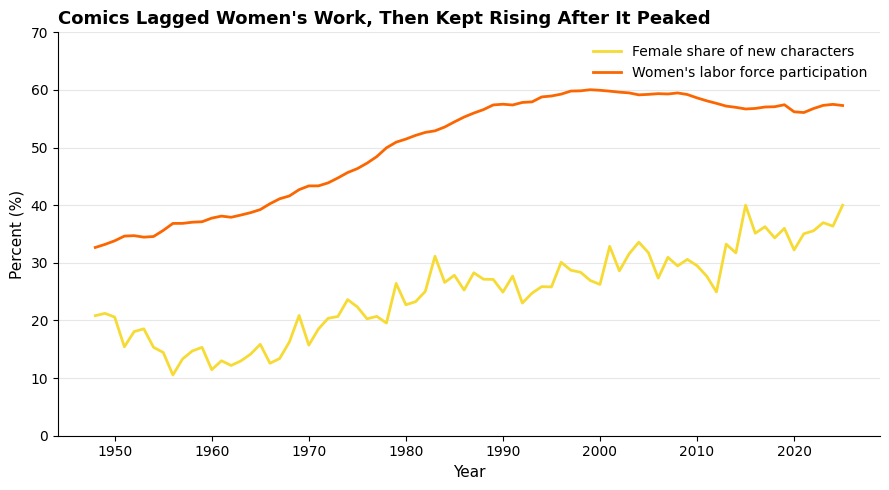
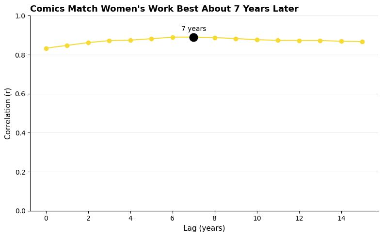
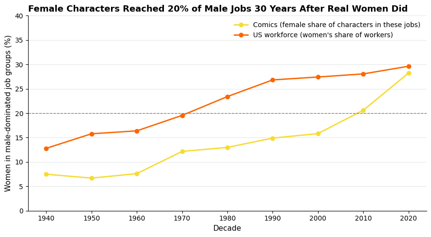

# Do Comics Mirror America?

Women at work in Marvel and DC characters compared with the real U.S. workforce, 1940 to 2025.

**Course:** BA 780, Introduction to Data Analytics, Boston University Questrom (MSBA)
**Team A07:** Daniel Igbokwe, Carly Barry, Eliza Bashirian, Albert Dorofeev (project manager), Emanuele Borroni
**Tools:** Python, pandas, NumPy, Matplotlib, seaborn, Google Colab

## The question

Marvel and DC say their characters should reflect their audience, but nobody on the editorial side has a number for how far the characters sit from the society they depict. We built that number. The project compares the jobs of nearly 50,000 comic characters with what real American women were doing at the same time, and asks where comics keep up and where they fall behind.

## Key findings

| Finding | What the number means |
|---|---|
| Comics trail the workforce by about **7 years** | The female share of new characters tracks women's labor force participation (r = 0.83). The match is strongest against the workforce 7 years earlier (r = 0.89). This shows a lag, not that comics react to society. |
| New characters changed fast, the roster did not | The roster is still about **70% male**, but women made up **11.5%** of new characters in 1960 and **40.0%** in 2025. |
| Female characters get "women's jobs" | The jobs held by female characters are on average **50.1% female** in the real workforce, against **42.9%** for male characters. |
| Male-dominated jobs opened late | In jobs that were under 30% women in 1940, real women passed 20% in the **1980s**. Female characters passed it in the **2010s**. |
| Fewer working lives for women | **57.1%** of female characters have an occupation listed, against **66.7%** of male characters. |







## Recommendations for an editorial team

1. Benchmark the gender mix of new characters against current workforce data every year, instead of matching where society was years ago.
2. Cast new female characters in managerial, professional and other historically male roles, where comics trail reality by decades.
3. Give every new character a civilian occupation so characters read as people with working lives.

## Data

| Source | What it gave us |
|---|---|
| [Marvel Database](https://marvel.fandom.com/wiki/Category:Earth-616/Characters) (Fandom) | 37,204 character pages, scraped 29 Sep 2026 |
| [DC Database](https://dc.fandom.com/wiki/DC_Comics_Database) (Fandom) | 14,671 character pages, scraped 29 Sep 2026 |
| [IPUMS USA](https://usa.ipums.org/usa/) | Share of women in each occupation, Census 1940 to 2000 and ACS 2001 to 2023 |
| [BLS via FRED](https://fred.stlouisfed.org/series/LNS11300002) | Women's labor force participation rate, 1948 to 2026 |

Fandom content is CC BY-SA 3.0 and FRED data is public domain. IPUMS data cannot be redistributed, so the raw files are not in this repo. You can download the extract from IPUMS using the occupation (OCC1950) by sex tabulation described in the notebook.

## How we built it

1. **Cleaned two messy wiki tables.** Gender had 83 raw values (typos, editor notes, identities that changed over time) that we grouped into Male, Female, Other and Unknown. Occupation was free text with wiki markup, so we kept each character's first current job.
2. **Sorted about 15,000 free-text jobs** into 11 census job groups plus comic-only groups such as Criminal, Hero/Adventurer and Royalty/Mystic, using an ordered keyword list that we checked by hand.
3. **Removed 1,953 DC reboot duplicates.** DC gives one character several pages across reboots. Left alone, this created a false wave of new characters in the 2010s.
4. **Joined comics to real data** on job group and decade, and on year for the labor force series.
5. **Answered 16 questions in four parts.** Each has a hypothesis, an answer, an interpretation and a caveat. The parts cover the baseline roster, the lag with the workforce, what jobs women get, and whether women are written with working lives at all.

## My contribution

I built the cleaning logic for the gender and occupation columns and worked with the team to decide how the original occupation values should group into job buckets. I also rewrote my own code into clearer, better commented functions.

## Limitations

- Female results rest on smaller groups (12,334 female vs 35,086 male characters).
- Only 10,832 characters hold a census-type job, so job comparisons cover about a fifth of the roster.
- Job groups are broad, and the "male-dominated" label is fixed at 1940.
- Wiki data is written by volunteers, so a missing gender or job may just be an incomplete page.
- Both series rise over time, so a high correlation does not prove the workforce caused the change in comics.
- The 2020s are an unfinished decade.

## Run it yourself

1. Open `Final-A07-Do-Comics-Mirror-America.ipynb` in Google Colab.
2. Put the four CSV files in a Drive folder called `000-Project/Datasets`, or in a local `data/` folder.
3. Run all cells. The notebook finds the folder on its own.

## Next steps

- Compare the powers given to male and female characters and how that changed over time.
- Weight characters by number of appearances so minor characters count less than leads.
- Add race and ethnicity using census data on the same jobs.

## Repo contents

```
.
├── README.md
├── Final-A07-Do-Comics-Mirror-America.ipynb
└── images/
```
